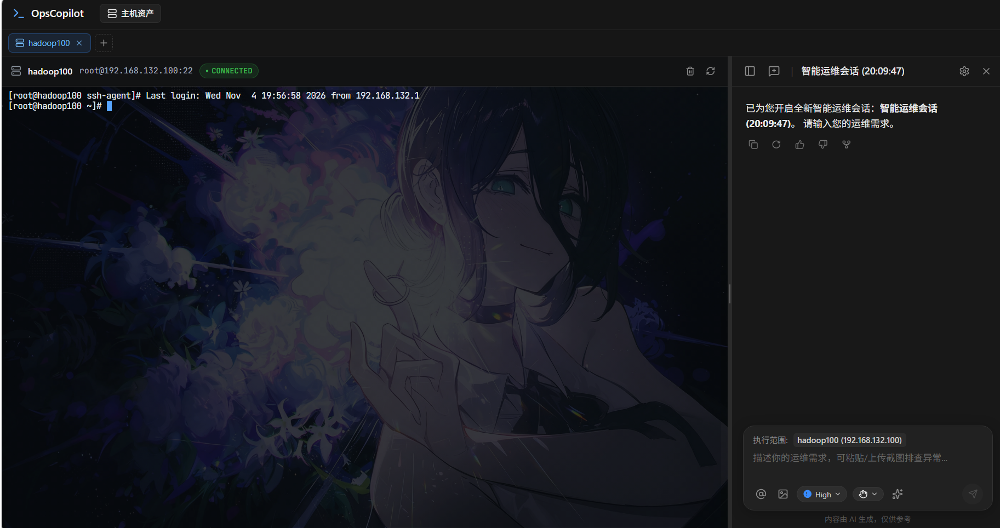

<div align="center">

# OpsCopilot · 智巡

**面向 Linux 主机的自主排障与变更执行 AI Agent**
**在真实的 WebSSH 终端上，完成“思考 ➔ 审计 ➔ 审批 ➔ 执行 ➔ 观察”全闭环**

[](https://python.org) [](https://fastapi.tiangolo.com) [](https://langchain.com) [](https://react.dev) [](https://www.typescriptlang.org) [](https://xtermjs.org) [](https://asyncssh.readthedocs.io)

**简体中文** · [架构设计](#系统架构) · [核心能力](#核心技术能力) · [接口速查](#接口速查) · [本地开发](#本地开发与快速启动) · [安全设计规范](#2-ast-语法树安全门禁-ast-security-guard)

</div>

OpsCopilot 面向基础设施运维工程师，将传统的黑盒 AI 问答升级为**工作在真实 Linux 终端上的全双工智能协同工作台**。左侧是原汁原味的 WebSSH 交互式终端，右侧是基于 LangGraph 状态机编排的 ReAct 智能体。支持自主探查根因、AST 深度解包安全门禁、多轮排障推演、断点续跑与检查点分支回溯，并通过**静态提示词前缀 + 只追加消息历史**最大化 Prompt Cache 命中率。

---

## 界面预览

### 主机资产管理


### 一体化终端与 AI 排障工作台


---

## 终端与排障一体化工作台

界面采用左右分屏响应式设计，终端输入与 Agent 自动化执行处于同一个真实 PTY 会话中，全程**同屏可见、按需介入、实时拦截**。

### 1. 一体化工作台：同屏双工执行
- **左侧**：基于 `@xterm/xterm` 的低延迟真实 WebSSH 终端，支持 ANSI 原生彩色回显、Tab 补全与 Vim/Top 交互。
- **右侧**：ReAct 闭环推演面板，将大模型的思考链（Thought）、执行动作（Action）、观察结果（Observation）解耦呈现。
- **协同**：Agent 的命令直接键入当前终端画布，执行过程对运维工程师 100% 透明可见；分屏支持拖拽缩放与状态持久化。

### 2. HITL 安全门禁：命令审批与文件变更 Diff
- 遇到破坏性指令（如 `rm -rf`、磁盘写入、防火墙封堵、核心服务重启）时，执行立即挂起，弹出人机协同（HITL）审批卡片。
- 支持**单次放行**、**当前会话放行**与**拒绝并要求模型重新规划**。
- 提供内置 **File Diff 对比查看器**，在修改 Nginx/系统配置文件前直观对比变更增删，杜绝恶意覆盖。

### 3. 时间旅行推演：检查点分支分叉 (Branch Fork)
- 基于 LangGraph 状态检查点与会话树（Session Tree）设计。
- 允许工程师在排障中途的**任意历史步骤点击“分叉分支”**，克隆当前上下文并开启一条全新的假设性推演链路（如：“如果当时不用重启而是杀孤儿进程会怎样？”），不污染原排障记录。
- 分叉请求的 `branch_from_session_id` 与 `branch_step_idx` 必须成对出现，且切入点必须真实存在；参数缺失或越界会直接报错，不会静默降级为普通会话。
- **实现边界**：检查点当前为进程内存储（`MemorySaver`），服务重启后历史分支不再保留；切换持久化 Checkpointer 后可跨重启回溯。

### 4. 双模式对话：Chat 与 Agent
- 输入框工具栏可切换对话模式：`Chat` 走单次问答接口（`/agent/chat`，不调用工具，适合快速咨询）；`Agent` 走 ReAct 闭环（`/agent/react`，自动执行命令并推演）。
- 两种模式共享会话历史（`chat_session`），切换模式不会丢失上下文；模型输出的 `<think>` 推理片段在渲染层统一隐藏。

<details>
<summary>展开查看：断线重连、自愈与深度执行细节（点击展开）</summary>

#### 断点续跑与事件缓冲回放
- 针对生产环境常见的浏览器意外刷新、网络抖动，后端维护 `RunEventBroker` 定长事件缓冲（上限 2000 条 SSE 事件，任务结束后保留 120 秒）。
- 刷新页面后前端携带会话 ID 自动发起 `attachRunningTask`，快速重放历史推演事件并无缝重连进行中的后台任务。

#### PTY 双工键入与 0.3s PS2 续行自愈
- 解决 LLM 偶尔输出未闭合单双引号导致终端挂死在 `>`（PS2 提示符）的问题：Agent 内置续行侦测器，在 0.3 秒内自动下发 `\x03` (Ctrl+C) 中断并恢复 Shell 提示符，重置终端状态。

#### 会话并发防重与文件排他锁
- 会话级并发拦截，防止重复触发引起状态混乱（触发 HTTP 409 互斥）。
- 运行时提供 `(host, path)` 粒度的全局文件互斥锁，防止多任务并发修改损坏关键配置。

</details>

---

## 核心技术能力

### 1. 结构化 ReAct 闭环与动态工具路由
- **状态图编排**：基于 LangGraph 构建图节点流转（`Think` ➔ `Audit` ➔ `ApprovalGate` ➔ `Act` ➔ `Observe` ➔ `Finish`）。
- **防发散与双守卫**：在 Think 节点前置步数与 Token 预算守卫，并在单目标只读查询（如查询磁盘、查进程）成功获取数据后触发**强收敛机制**，杜绝大模型在拿到结果后依然陷入死循环无效发散。
- **动态工具路由**：每轮根据用户目标与最近一步执行回显，从全量内置 / MCP 工具中筛选出当前步骤相关的工具，仅下发必要 schema；命令执行与任务收敛作为基线工具始终保留。
- **工具白名单校验**：路由结果同时作为硬性白名单，解析层与执行层双重校验；非法工具调用会降级为纯文本兜底，不会越权执行。
- **双协议兼容**：同时支持基于 JSON Schema 的原生 Tool Calling 与正则文本协议解析，适配海内外主流大模型。

### 2. AST 语法树安全门禁 (AST Security Guard)
- **拒绝 Prompt 纸面约束**：针对 `su -c`、`bash -c`、`find -exec`、管道喂解释器（`curl | sh`）等常见绕过提示词攻击的手段，基于 `bashlex` 构建 AST 解析器。
- **多层递归解包**：递归拆解 25 种前缀包装命令（`sudo`, `xargs`, `nohup`, `timeout`, `systemd-run` 等）并审计底层真实载荷。
- **内联代码递归审计**：内置 Python AST 解析器与正则扫描，对 `python -c`、`awk 'system()'` 等 7 类脚本语言内联载荷实施深度安全阻断。
- **Fail-Secure 兜底**：AST 解析失败时不降级放行——命中毁灭性特征直接硬阻断，其余一律升级为强制人工复核；审计器异常同样阻断执行。

### 3. 上下文预算治理、惰性压缩与 Prompt Caching
- **模型容量画像**：支持 `1m`（Gemini 2.5 Pro / Qwen2.5-1M）、`128k`（DeepSeek-V3 / GPT-4o）、`32k`（GLM-4 / Claude）与 `standard` 四级 Token 与窗口策略。
- **共享预算池**：引擎统一从 `context_pool_tokens` 中扣除工具 schema 与输出预留，再按 2:1 分配给步骤历史与会话历史，固定开销只扣一次，避免两个压缩器重复预留。
- **输出 Token 预留**：按画像为模型输出预留 1200~6000 tokens，防止输入贴近窗口上限时输出被截断。
- **结构化事实压缩**：超出滑动窗口的前序步骤自动提取为结构化“运维事实三元组”（执行意图、关键退出码与精简指标），仅保留最近轮次的原始物理回显。
- **智能双端截断**：单步过长回显实施首尾比例智能截断（Head 30% + Tail 70%），兼顾报错原因与最后输出。
- **惰性压缩**：步骤历史仅在跨越窗口或超出预算时折叠，会话历史仅在达到 Token 阈值时压缩；未触发时保持原始前缀不变。
- **Prompt Cache 友好消息流**：System 提示纯静态、运行时环境与任务目标放在稳定的初始任务消息中，ReAct 历史以 assistant / observation 消息只追加；压缩仅发生在前缀确实超限时。
- **缓存命中观测**：解析上游 `usage` 中的 `cached_tokens` / `prompt_cache_hit_tokens`，按步骤输出缓存命中率日志，便于评估 Caching 效果。
- **实测收益**：15 步、每步约 2000 字回显的样本，历史 token 由 21,519 降至 11,862（128k 画像）/ 7,649（32k 画像）。

---

## 系统架构

```text
┌────────────────────────────────────────────────────────────────────────┐
│                        前端工作台 (ssh-client)                          │
│   React 19 + TypeScript + Vite + xterm.js + Event Reducer 状态归约     │
│   ┌──────────────────────────┐      ┌──────────────────────────────┐   │
│   │   WebSSH 交互终端 (PTY)   │      │    AI 协同推演面板 (ReAct)   │   │
│   └─────────────▲────────────┘      └──────────────▲───────────────┘   │
└─────────────────┼──────────────────────────────────┼───────────────────┘
                  │ WebSocket (双工数据流)             │ SSE (事件流) / REST
┌─────────────────┼──────────────────────────────────┼───────────────────┐
│                 │       后端引擎 (ssh-agent)       │                   │
│   ┌─────────────▼────────────┐      ┌──────────────▼───────────────┐   │
│   │ TerminalSessionManager   │      │ LangGraph ReAct 状态机引擎    │   │
│   │ (PTY 捕获 / PS2 自愈)     │      │ (Think/Act/Observe/Finish)   │   │
│   └─────────────▲────────────┘      └──────────────▲───────────────┘   │
│                 │                                  │                   │
│                 │                   ┌──────────────┴───────────────┐   │
│                 │                   │ AST 安全门禁 (bashlex 解包)   │   │
│                 │                   │ 25 种包装器 + 7 类解释器载荷  │   │
│                 │                   └──────────────▲───────────────┘   │
│                 │                                  │ (审计通过后下发)   │
│                 └─────────────────┬────────────────┘                   │
│                                   ▼                                    │
│                   asyncssh 网关通道 (SSHv2 / SFTP)                     │
└───────────────────────────────────┼────────────────────────────────────┘
                                    ▼
                    目标 Linux 服务器 (Debian / CentOS / Ubuntu)
```

---

## 适合与不适合场景

- **非常适合**：
  - 生产系统应急排障（如磁盘突然占满分析、CPU 负载飙高定位、端口连通性排查、僵尸进程清理）。
  - 日常配置安全修改（如 Nginx 反向代理配置变更、防火墙规则增删，配合 Diff 比对与人工复核）。
  - 复杂链路推演与多方案对比（通过检查点分支同时尝试重启服务 vs 调优配置两种路径）。
- **安全边界与限制**：
  - 底层破坏性磁盘操作（如 `mkfs`、`fdisk`、`dd of=/dev/sdX`）与根目录递归删除触发**硬阻断**，即使用户批准也不会盲目执行。
  - 需要可访问的大模型服务：公网 API 或本地私有部署（兼容 OpenAI / DeepSeek / GLM 协议）。

---

## 接口速查

| 方法 | 路径 | 说明 |
| :--- | :--- | :--- |
| `POST` | `/api/v1/hosts` | 注册受管主机并返回主机 ID |
| `GET` | `/api/v1/hosts` | 查询受管主机资产列表 |
| `GET` | `/api/v1/hosts/{id}` | 查询主机详情（凭据脱敏） |
| `DELETE` | `/api/v1/hosts/{id}` | 软删除受管主机 |
| `POST` | `/api/v1/hosts/{id}/test` | 测试 SSH 连通性与凭据 |
| `WS` | `/ws/hosts/{id}/terminal` | 建立 WebSSH PTY 双工通道 |
| `GET` | `/api/v1/hosts/{id}/agent/sessions` | 查询主机下的对话会话列表 |
| `POST` | `/api/v1/hosts/{id}/agent/sessions` | 新建对话会话 |
| `GET` | `/api/v1/agent/sessions/{session_id}` | 查询会话详情与历史消息 |
| `DELETE` | `/api/v1/agent/sessions/{session_id}` | 删除会话及其消息与里程碑 |
| `POST` | `/api/v1/hosts/{id}/agent/chat` | Chat 模式：单次问答，SSE 流式返回（不调用工具） |
| `POST` | `/api/v1/hosts/{id}/agent/react` | Agent 模式：发起 ReAct 推演并以 SSE 流式下发事件 |
| `GET` | `/api/v1/hosts/{id}/agent/react/stream` | 回放缓冲事件并接续后台任务 |
| `GET` | `/api/v1/hosts/{id}/agent/react/status` | 查询会话是否仍有后台任务运行 |
| `POST` | `/api/v1/hosts/{id}/agent/react/approve` | 提交高危命令审批决定 |
| `POST` | `/api/v1/hosts/{id}/agent/react/cancel` | 取消正在后台运行的推演任务 |
| `POST` | `/api/v1/hosts/{id}/agent/react/steer` | 推演中途插话纠偏 |
| `GET` | `/api/v1/memories` | 查询核心记忆（core_memory） |
| `POST` | `/api/v1/memories` | 新增核心记忆 |
| `GET` | `/api/v1/memories/long-term` | 查询长期记忆（long_term_memory） |

服务启动后可访问 `http://127.0.0.1:8000/docs` 查看完整 Swagger 文档。

---

## 本地开发与快速启动

系统由两个独立工程组成：`ssh-agent`（后端）与 `ssh-client`（前端）。

### 环境前置要求
- **Python**: 3.10 或更高版本
- **Node.js**: 20.x 或更高版本（支持 npm/pnpm）
- **目标测试机**: 任一开放 SSH 22 端口的 Linux 主机（支持密码或私钥连接）

---

### 1. 启动后端服务 (`ssh-agent`)

```bash
cd ssh-agent

# 1. 创建并激活虚拟环境
python -m venv .venv
# Windows:
.venv\Scripts\activate
# Linux/macOS:
# source .venv/bin/activate

# 2. 安装依赖
pip install -r requirements.txt

# 3. 配置环境变量
cp .env.example .env
# 编辑 .env，填入你的大模型 API KEY (如 DEEPSEEK_API_KEY 或 OPENAI_API_KEY)

# 4. 启动后端 API 与 WebSocket 服务 (默认监听 8000 端口)
python -m uvicorn adapter.web.main:app --host 0.0.0.0 --port 8000 --reload
```

#### 配置项说明

| 环境变量 | 必填 | 说明 |
| :--- | :--- | :--- |
| `LLM_API_KEY` | 是 | 大模型 API Key |
| `LLM_BASE_URL` | 否 | OpenAI 兼容端点，默认 `https://api.openai.com/v1` |
| `LLM_MODEL` | 否 | 模型名称，默认 `gpt-4o` |
| `LLM_ENABLE_THINKING` | 否 | 是否开启思维链输出（取决于模型支持） |
| `SMARTOPS_DATABASE_URL` | 否 | 数据库连接串，默认本地 SQLite，可切换 MySQL / PostgreSQL |
| `SMARTOPS_DB_ECHO` | 否 | 是否输出 SQLAlchemy SQL 执行日志，默认关闭 |
| `SMARTOPS_DB_NULL_POOL` | 否 | 是否禁用数据库连接池（测试环境启用，连接用完即关），默认关闭 |
| `SMARTOPS_SECRET_KEY` | 否 | 凭据加密主密钥，缺省自动生成并持久化到 `.smartops_secret_key` |
| `MCP_SERVERS` | 否 | 外部 MCP Server 配置（JSON 数组），留空则不启用 |

---

### 2. 启动前端工作台 (`ssh-client`)

```bash
cd ssh-client

# 1. 安装前端依赖
npm install

# 2. 启动 Vite 开发服务器 (默认监听 5173 端口)
npm run dev
# 若 5173 端口被系统占用，可改用其他端口：
# npm run dev -- --port 3000

# 3. 生产产物构建与代码检查
npm run lint
npm run build
```

在浏览器中访问 **`http://localhost:5173`** 即可进入一体化排障工作台。

---

### 3. 测试与验证

```bash
# 全量用例（202 条 = 69 单元 + 133 集成）
python -m pytest tests/

# 仅快速单元测试（无数据库 / ASGI 依赖，秒级完成）
python -m pytest tests/unit

# 仅集成测试（覆盖 SSE、PTY、审批、MCP、并发与断线续跑）
python -m pytest tests/integration
```

---

## 项目工程结构

```text
.
├── ssh-agent/                           # 后端（洋葱架构）
│   ├── domain/                          # 核心领域实体与安全策略规则
│   ├── config/                          # 环境变量集中加载与运行期配置快照
│   ├── application/                     # LangGraph ReAct 引擎、上下文治理与用例编排
│   │   ├── react/                       # 状态机、动态工具路由、共享预算与只追加消息流
│   │   └── runtime/                     # (host, path) 写锁、会话树分支推演
│   ├── adapter/                         # 外部基础设施适配层
│   │   ├── ssh/                         # asyncssh PTY 双工管理与 0.3s PS2 续行自愈
│   │   ├── security/                    # bashlex AST 25 种包装器解包与 Python 载荷审计
│   │   ├── web/                         # FastAPI 路由、SSE 响应流与依赖装配 (factory.py)
│   │   └── event_bus/                   # RunEventBroker 事件缓冲与断线回放
│   ├── tests/                           # 202 条用例（unit 69 / integration 133）
│   └── run.py                           # 后端启动入口
│
└── ssh-client/                          # 前端（React 19 + TypeScript 工作台）
    ├── src/
    │   ├── components/agent/            # ReAct 步骤卡片、HITL 审批对话框、File Diff 对比器
    │   ├── components/terminal/         # xterm.js 终端封装与 Resize 监听
    │   ├── hooks/                       # useReActStream (SSE 消费与断点续跑)
    │   ├── utils/reactEventReducer.ts   # 细粒度流式事件状态机归约器
    │   └── views/TerminalHostWorkspace  # 左右分屏一体化运维工作台
    └── package.json
```

---

## 许可证

本项目采用 MIT 许可证。欢迎提交 Issue 与 Pull Request 共同改进！
